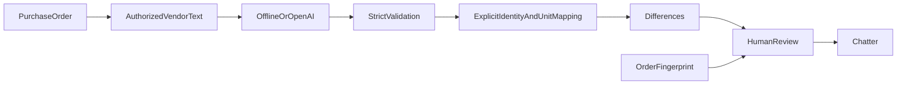

# Procurement auditor source scope

Odoo 17 purchase button, immutable source/order fingerprints, extracted JSON,
strict Pydantic validation, vendor SKU/UoM aliases, quantity/price/currency/product
comparison, missing/unexpected/duplicate lines, line/subtotal rounding checks,
discrepancy table, chatter summary and authorized human review are authored.
Offline mode parses provided fictional structured JSON and performs the same
validation/comparison as the OpenAI extraction path. It is explicitly an offline
parser, never a fake successful AI call. Copy either demo_data confirmation into
the seeded PO audit; change currency to your configured order currency if needed.

OpenAI mode preserves the requested gpt-4o-mini model, uses strict JSON-schema
structured output and requires an environment key plus explicit allow_external.
Vendor text is untrusted user-role data; instructions are isolated in the system
message. No tools are given to the model. Only usage counts and request ID are
logged; document content remains in access-controlled Odoo audit records. The
network is blocked by default Compose configuration. No paid request was made.

The init script builds the provided derivative image before either mode;
its Dockerfile adds pinned Pydantic to the digest-pinned Odoo base.
No dependency installation or image build has been executed. Plain UTF-8 text/JSON attachments linked to the same purchase order are
supported; PDF/OCR extraction, asynchronous production queues and automatic PO
correction are not included. Findings require manager review. Historical prompts,
thresholds and measured time savings are not claimed. Runtime validation for this source snapshot was deferred by request.

Official references consulted:
https://developers.openai.com/api/docs/guides/structured-outputs
https://developers.openai.com/api/docs/models/gpt-4o-mini

